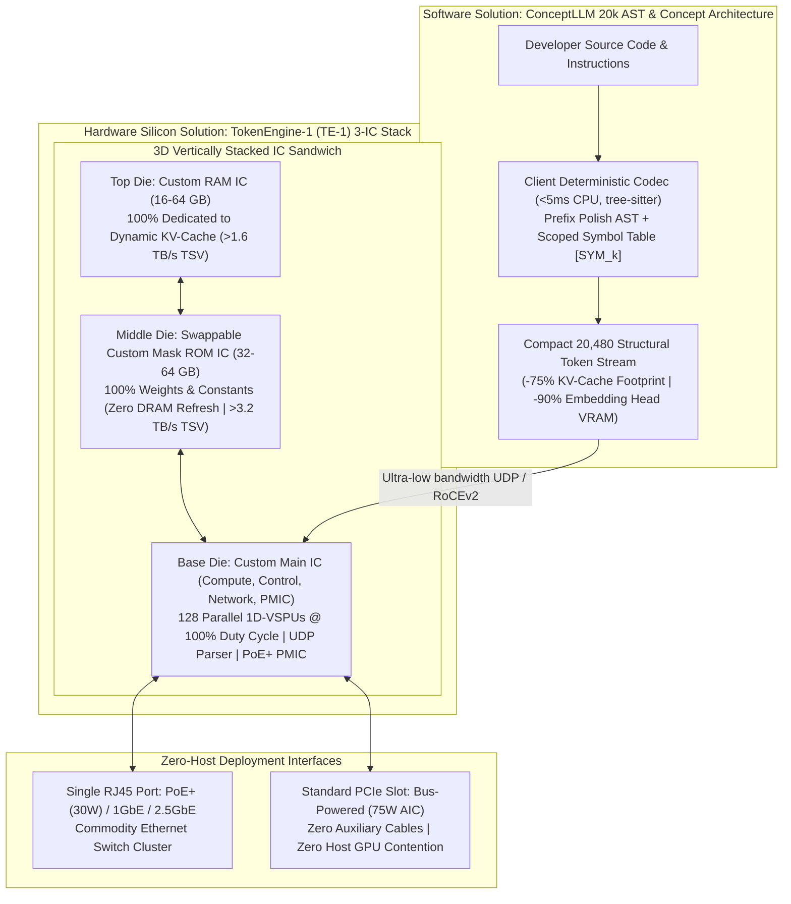
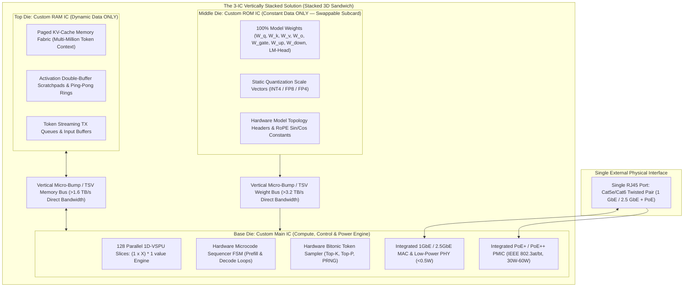

# ConceptLLM: Unified Co-Designed AI Architecture (Software & Silicon)

**ConceptLLM** is an end-to-end, co-designed AI computing platform built to eliminate the compounding computational, memory, and energy inefficiencies of generative language model inference.

Traditional AI architectures suffer from a double inefficiency:
1. **At the Software / Token Level:** Models waste 70%–80% of their context window and autoregressive FLOPs parsing whitespace, syntax boilerplate, and repeating long identifier names across bloated 150k–256k BPE tokenizers.
2. **At the Silicon / Hardware Level:** Datacenter GPUs (H100/H200) run 2D systolic arrays that sit >90% idle during single-token autoregressive decoding, consume hundreds of watts of DRAM refresh power holding static weights in volatile memory, and require multi-thousand-dollar host servers, complex liquid cooling, and 3kW power feeds.

ConceptLLM solves this holistically through two complementary, tightly integrated solutions:
- **[Software Solution (SOFTWARE.md)](SOFTWARE.md):** An **Edge-Cloud AST & Concept Split Architecture** that replaces BPE with a **20,480 unified code-concept vocabulary**, slashing boundary projection matrices by **~90%**, compressing repository KV-caches by **~75%**, eliminating syntax errors by construction, and boosting generation throughput by **3× to 4×**.
- **[Hardware Silicon Solution (AI_CHIP_DESIGN.md)](AI_CHIP_DESIGN.md):** The **TokenEngine-1 (TE-1)**, a **3-IC vertically stacked inference accelerator** (Main IC + Swappable Mask ROM IC + Dynamic RAM IC) powered by **1D-VSPU slices** (`(1 × X) * 1 value`), operating at **100% compute duty cycle** within a **20.5W PoE+ Ethernet cable** or **PCIe PC card**, cutting energy per token by **>34× to 50×**.

---

## High-Level System Architecture: Software + Silicon Co-Design

---

## 1. Solution 1: Software Architecture (20,480-Token ConceptLLM)

> **Full Specification:** See [SOFTWARE.md](SOFTWARE.md) for complete grammar schemas, symbol table semantics, mathematical proofs, and training pipelines.

### The Problem
Modern coding models spend massive amounts of context capacity reading and emitting whitespace indentation, closing braces, semicolons, and spelling out long descriptive variable names (e.g. `unauthenticated_user_retry_count` split into 6 BPE tokens every time it appears). Furthermore, boundary layers ($|V| \times d_{\text{model}}$) with 150k–256k tokens waste gigabytes of VRAM.

### Core Innovations
1. **Fixed-Arity Prefix (Polish) AST Notation:** Deterministically parses code via `tree-sitter` in `<5 ms` on CPU into prefix order. Binary operators have fixed arity 2, unary have arity 1, and conditionals have arity 3. Parentheses, brackets, colons, and semicolons are completely eliminated.
2. **Scoped Symbol Table & Semantic Decomposition:** Long multi-word identifiers are split **once** in a header into semantic concept tokens (e.g. `[DECL_SYM:42] [MOD:NEG] [CONCEPT:AUTH] [CONCEPT:USER] [CONCEPT:RETRY] [CONCEPT:COUNT]`). Every subsequent occurrence in the file or repository is a single token `[SYM_42]`. The client restores the exact original string in $O(1)$ time via a local hash table.
3. **Surgical AST-Level Diffs:** Replaces fragile line-based `SEARCH/REPLACE` blocks with AST subtree replacements (`[PATCH_NODE:SYM_14]`), preventing syntax and indentation breakages.
4. **Grammar-Constrained Decoding:** A Pushdown Automaton (PDA) logit mask prevents illegal AST transitions and masks out unallocated symbol slots, mathematically preventing hallucinated variable names and syntax errors (**0.0% syntax error rate**).

### Vocabulary Architecture (20,480 Tokens)

| Token Tier | ID Range | Size | Description |
| :--- | :--- | :--- | :--- |
| **AST & Grammar Operators** | `0x0000 – 0x05DF` | 1,504 | Fixed-arity Polish AST nodes, types, and mutability/visibility flags. |
| **Scoped Symbol Table Slots** | `0x05E0 – 0x157F` | 4,000 | Repository & local identifier pointers (`[SYM_k]`) and new symbol slots (`[NEW_SYM_k]`). |
| **Stdlib & Framework APIs** | `0x1580 – 0x2907` | 5,000 | Single-token canonical primitives (`std::vector`, `asyncio.gather`, `tokio::spawn`, CUDA). |
| **Technical Concepts & Roots** | `0x2908 – 0x4E1F` | 9,496 | Technical lemmas and sub-identifier roots (`alloc`, `buffer`, `mutex`, `auth`, `retry`). |
| **Byte Fallback** | `0x4E20 – 0x4F1F` | 256 | Raw bytes (`0x00 – 0xFF`) for arbitrary string literals and hex constants. |
| **Control & AST Patching** | `0x4F20 – 0x4FFF` | 224 | Block terminators (`[END_BLOCK]`), AST patch markers, dialect tags, and `<EOS>`. |

### Key Software Metrics
- **Boundary Head VRAM Reduction:** **~90%** ($6.55\text{ GB} \to 0.67\text{ GB}$ on frontier models).
- **Repository Context Compression:** **~3.5×** sequence length compression.
- **KV-Cache Footprint:** **~75% reduction** in cluster KV-cache VRAM.
- **Generation Speed:** **3× to 4× faster** end-to-end token emission.

---

## 2. Solution 2: Hardware Silicon Architecture (TokenEngine-1 / TE-1)

> **Full Specification:** See [AI_CHIP_DESIGN.md](AI_CHIP_DESIGN.md) for complete microarchitecture, TSV interconnect, thermal dissipation, safe-swap fixtures, and form-factor schematics.

### The Problem
Autoregressive decoding is batch-1 and memory-bandwidth bound. Datacenter GPUs (H100/H200) execute batch-1 token generation with **>90% MAC idle underutilization**, consume massive DRAM refresh power holding static weights, and require heavy host servers with high-power x86 CPUs, PCIe Gen5 switches, and 3kW power feeds.

### Core Innovations
1. **The 3-IC Vertically Stacked Architecture:**
   - **Top Die (Custom RAM IC, 16–64 GB):** Strictly dynamic data only (paged KV-cache, scratchpads). **Zero weights stored in RAM**, reserving 100% of RAM capacity for multi-million token contexts ($>1.6\text{ TB/s}$ TSV bus).
   - **Middle Die (Custom ROM IC, 32–64 GB):** Strictly immutable model constants (100% of weights, quantization scales, RoPE tables). 3D Mask ROM draws **zero DRAM refresh power** and boots instantly ($<50\text{ ms}$). Modular swappable subcard allows model upgrades in $<10\text{s}$ for ~$10–$25 per ROM without replacing the compute silicon.
   - **Base Die (Custom Main IC):** Contains 128 parallel 1D-VSPU slices, microcode sequencer FSM, bitonic token sampler, integrated Ethernet MAC/PHY (<0.5W), and integrated PoE+ PMIC.
2. **1D-VSPU Compute Primitive `(1 × X) * 1 value`:** Built specifically for vector-scalar autoregressive decoding. Runs at **100% arithmetic duty cycle** with zero idle systolic cycles.
3. **Plug-and-Play Network Silicon:** Single RJ45 copper interface with native IEEE 802.3at PoE+ (20.5W typical power). Plugs directly into standard commodity PoE switches—zero host CPUs, zero PCIe switches, and zero power bricks.
4. **Deep Sleep Standby Mode:** Slashing standby power by **>97%** to **$<0.65\text{ W}$** after ~50ms of network idle time, waking in $<10\text{ }\mu\text{s}$.
5. **Desktop PCIe PC Card (AIC):** Standard bus-powered (75W) desktop add-in card with chassis-external rear safe-swap ROM cartridge and zero host GPU VRAM contention.

### 3-IC Stacked Die Breakdown

---

## 3. High-Level Comparison: Traditional AI vs. ConceptLLM (Software + Silicon)

| Dimension | Traditional Datacenter GPU Server | ConceptLLM Software + TE-1 Silicon | Compounding Advantage |
| :--- | :--- | :--- | :--- |
| **Token Representation** | 150k–256k BPE subwords; high syntax bloat | **20,480 Prefix AST + Scoped Symbol Table** | **3×–4× fewer tokens; 0% syntax errors** |
| **Boundary VRAM ($W_E, W_{LM}$)** | ~6.5 GB – 10 GB per replica | **~0.67 GB** | **~90% less boundary parameter overhead** |
| **Compute Primitive** | 2D Systolic Tensor Cores (Optimized for $M \gg 1$) | **1D-VSPU Slices `(1 × X) * 1 value` ($M=1$)** | **100% duty cycle vs. >90% idle MAC waste** |
| **Weight Storage** | Volatile DRAM/HBM (DRAM refresh overhead) | **Swappable 3D Mask ROM IC (Zero refresh power)** | **Zero refresh power; instant boot (<50 ms)** |
| **RAM Usage** | Shared: weights consume 40–70 GB of RAM | **100% of RAM dedicated to dynamic KV-cache** | **Multi-million token context (128k–5M+ tokens)** |
| **Host System Tax** | Dual x86 CPUs, 1.5TB DDR5, PCIe switches | **None: Autonomous micro-server on PoE LAN** | **Eliminates servers, power bricks, & cables** |
| **Engine Power Consumption**| 700W – 1000W per accelerator | **20.5W typical (PoE+ Class 4 powered)** | **>34× to 50× lower power per engine** |
| **Idle Standby Power** | 150W – 300W per GPU | **< 0.65W (Autonomous ~50ms Deep Sleep)** | **>97% standby power reduction** |
| **Energy per Token** | $\approx 1.12\text{ Joules / Token}$ (Batch=1) | **$\approx \mathbf{0.0328\text{ Joules / Token}}$** | **$34\times\text{ to }50\times$ lower energy per token** |
| **Serving Economics** | High cost per token; prohibitive long-context | **Ultra-low serving cost ("Free Kimi 3" economics)**| **>85% Total Cost of Ownership (TCO) reduction** |

---

## 4. Software + Hardware Synergy (Compounding Multipliers)

When the **ConceptLLM 20k Software Architecture** runs on **TE-1 3-IC Silicon**, their benefits multiply:

1. **Compounded End-to-End Energy Reduction ($>100\times$):**
   - Software token compression emits **$3\times\text{ to }4\times$ fewer tokens** per program function.
   - TE-1 silicon uses **$34\times\text{ to }50\times$ less energy** per emitted token ($0.0328\text{ J/token}$).
   - **Combined Result:** Producing the same complete, verified code function requires **$>100\times$ less total electrical energy** than running standard BPE models on GPU clusters.
2. **Context Memory Synergy:**
   - ConceptLLM compresses repository KV-cache tokens by **~75%**.
   - TE-1 dedicates **100% of its top-die RAM IC** to dynamic KV-cache.
   - **Combined Result:** A single 32 GB RAM IC can retain the active working context of a **2,000,000+ token software repository**, enabling deep architectural refactoring on a 20.5W edge device.
3. **Zero-Latency Ingestion:**
   - Deterministic client AST parsing (`<5 ms` on CPU) matches TE-1's hardware UDP streaming engine latency ($<350\text{ ns}$ cut-through), allowing immediate token streaming over standard Ethernet.

---

## 5. Repository Documentation Index

| Document | Primary Focus | Key Contents |
| :--- | :--- | :--- |
| **[SOFTWARE.md](SOFTWARE.md)** | **Software Architecture** | Full 20,480-token specification, Prefix Polish AST grammar, Scoped Symbol Table decomposition, surgical AST patching, grammar-constrained logit masking, training pipelines, and SWE benchmarks. |
| **[AI_CHIP_DESIGN.md](AI_CHIP_DESIGN.md)** | **Hardware Silicon Architecture** | Microarchitecture for TE-1 3-IC vertically stacked silicon, 1D-VSPU execution units, vertical TSV weight bus (>3.2 TB/s), PoE+ power delivery, swappable ROM safe-swap fixture, and Solo/PCIe/1U/2U/4U form factors. |

---

## 6. Project Roadmap

- [x] Complete technical specifications for both Software ([SOFTWARE.md](SOFTWARE.md)) and Silicon ([AI_CHIP_DESIGN.md](AI_CHIP_DESIGN.md)).
- [ ] **Software Phase 1:** Reference `tree-sitter` Prefix-AST + Scoped `[SYM_k]` bidirectional codec (Python, Rust, TypeScript, C++).
- [ ] **Software Phase 2:** Token compression benchmarks against `tiktoken` (`cl100k_base`, `o200k_base`) across real GitHub repositories.
- [ ] **Software Phase 3:** Continued pretraining / vocabulary surgery on a 0.5B–1.5B open coder model with grammar-constrained decoding.
- [ ] **Hardware Phase 1:** Cycle-accurate SystemC/Verilog simulation of 128-slice 1D-VSPU array and TSV memory interface.
- [ ] **Hardware Phase 2:** FPGA emulation of the on-chip network engine and hardware microcode sequencer.
- [ ] **Hardware Phase 3:** Tape-out and prototype assembly of the TE-1 3-IC stacked test vehicle and PCIe add-in card.
