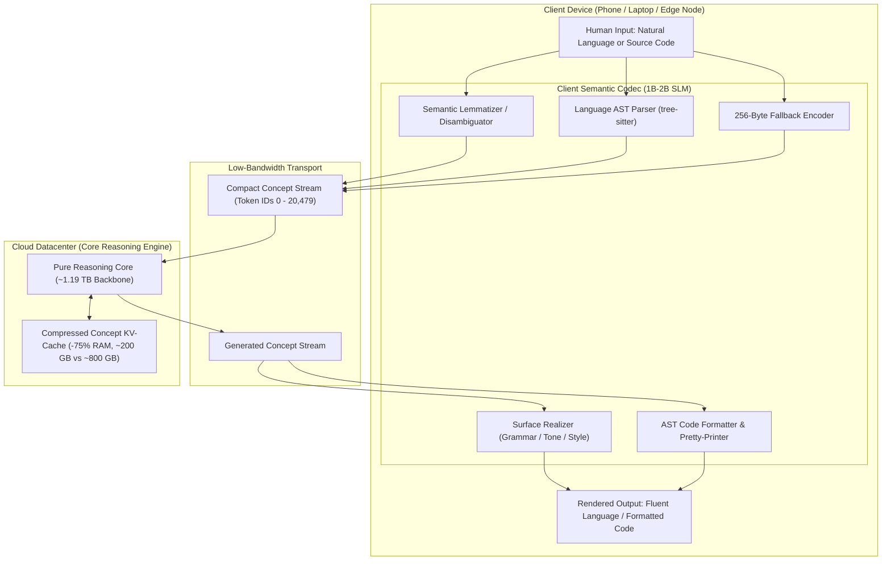
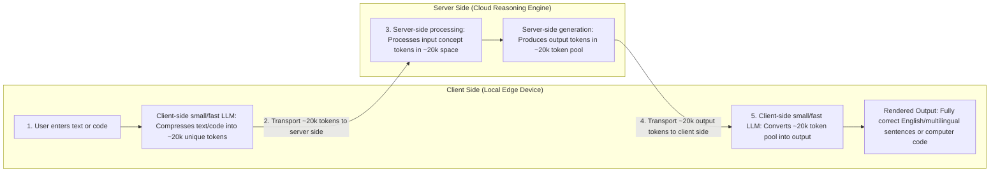

# ConceptLLM: Edge-Cloud Semantic Split Architecture
An experimental AI architecture that decouples **high-level conceptual reasoning** from **surface-level linguistic and code formatting**.

By replacing massive 200,000-token BPE vocabularies with a unified **~20,000 Concept Vocabulary** (incorporating semantic lemmas, programming AST nodes with scoped symbol tables, and byte-level fallbacks), this system slashes boundary projection matrices by **90%**, cuts KV-cache demands by **~75%**, and boosts effective generation throughput by **3× to 4×** across both cloud clusters and consumer edge devices.

---

## 1. Executive Summary & Problem Statement

Current frontier Large Language Models (LLMs) suffer from severe architectural inefficiency:
1. **Surface Redundancy:** A massive portion of an LLM's parameter capacity and training budget is wasted learning thousands of surface variations for the same fundamental concept (e.g., casing, plurals, verb tenses, multilingual duplicates, formatting tokens).
2. **Bloated Vocabularies:** Modern tokenizers (128k to 256k tokens) inflate boundary matrices. The most significant matrix size reduction is directly on **the input embedding and the final output head** layers, which scale proportionally with vocabulary size ($|V| \times d_{\text{model}}$). In traditional models, these two boundary layers consume up to 25%–40% of parameter memory in smaller/edge models and saturate memory bandwidth during inference.
3. **Power & Hardware Bottlenecks:** Datacenter clusters require terabytes of VRAM (e.g., 2 TB+ for clusters running models like Kimi k3 / DeepSeek / 400B+ models) largely driven by massive dynamic KV caches and dense parameter arrays that spend FLOPs outputting conversational filler.

**ConceptLLM** solves this by splitting the workload between an on-device **Client Semantic Codec** and a cloud **Core Reasoning Engine**.

---

## 2. System Architecture

### 2.1 Component Architecture



### 2.2 End-to-End Client-Server Flow



**Execution Pipeline:**
1. **User Input:** User enters text or code on the client device. A small, fast client-side LLM compresses the input into a compact representation using a ~20k unique token pool.
2. **Upstream Transport:** The ~20k concept tokens are transported across the network to the server.
3. **Server Processing & Generation:** The server-side core model processes the input tokens and produces output tokens, working entirely within the ~20k concept token pool.
4. **Downstream Transport:** The generated output tokens (~20k token size pool) are transported across the network to the client.
5. **Client Reconstruction:** The client-side LLM converts the ~20k token pool into fully correct, grammatical English (or other language) sentences or formatted computer code.


---

## 3. The 20,000 Unified Token Structure

Instead of arbitrary byte-pair statistics, the vocabulary space is strictly partitioned into three specialized functional tiers:

| Token Tier | ID Range | Size | Purpose & Characteristics |
| :--- | :--- | :--- | :--- |
| **Semantic Concepts** | `0x0000 – 0x464F` | ~18,000 | Canonical root concepts (lemmas), actions, universal entities, and semantic relationships (e.g., `[ACTION:ACCELERATE]`, `[CONCEPT:PHOTOSYNTHESIS]`). |
| **AST Nodes & Symbols**| `0x4650 – 0x4E1F` | ~2,000 | Language-agnostic programming AST nodes (e.g., `[FOR_LOOP]`, `[BIN_OP:ADD]`, `[VAR_DECL]`) and scoped symbol references (`[SYM_0]`, `[SYM_1]`). Guarantees syntax validity. |
| **Byte Fallback** | `0x4E20 – 0x4F1F` | 256 | Raw byte values (`0x00 – 0xFF`) for arbitrary literals, UUIDs, cryptographic hashes, and rare mathematical notation. |
| **Special Control** | `0x4F20 – 0x4FFF` | ~224 | Framing, delimiters, modality switches, and `<EOS>` markers. |
| **Total** | | **~20,480** | **Complete, closed-loop representation of language, code, and raw data.** |

---

## 4. Operational Walkthrough

### A. Natural Language Flow
1. **Input:** The user types: *"Could you please give me a summary of how photosynthesis works?"*
2. **Client Compression:** The local lightweight model (1B–2B parameters) strips polite filler and surface syntax into dense concept tokens:
   ```
   [ACTION:SUMMARIZE] [CONCEPT:PHOTOSYNTHESIS] [PROCESS:MECHANISM]
   ```
3. **Server Inference:** The server processes 3 concept tokens instead of 14 BPE tokens. It computes the factual transition and outputs:
   ```
   [CONCEPT:PLANT] [ABSORB:SUNLIGHT] [INPUT:H2O+CO2] [OUTPUT:GLUCOSE+O2]
   ```
4. **Client Expansion:** The local model expands the concepts into fluent natural language matching the user's preferred tone:
   > *"Photosynthesis is the process where plants absorb sunlight to convert water and carbon dioxide into glucose and oxygen."*

### B. Programming & Code Flow
1. **Input:** The user requests an algorithm or system routine in Rust, C++, or Python.
2. **Identifier Predefinition:** Custom function and variable names (e.g., `cudaMallocAsync`, `worker_buffer`) are predefined **only once** in a scoped symbol table.
3. **Server Inference:** The server generates pure **AST Node Tokens** and references names using compact symbol tokens like `[SYM_0]`, `[SYM_1]`:
   ```
   [DECL_FUNC:SYM_0] ... [CALL_EXPR:SYM_0] [ARG_LIST:SYM_1]
   ```
   * **Drastic Token Reduction:** Instead of spelling out long identifiers letter-by-letter using 10–25 byte fallback tokens on each occurrence, repeating the function/variable name costs only **1 token** (`[SYM_0]`).
4. **Client Pretty-Printing:** The client's tree-sitter formatter resolves the symbol table back to human names and compiles the AST directly into valid code:
   * **No missing brackets or indentation errors** (syntax correctness is guaranteed by the grammar tree).
   * **Language flexibility:** The same AST can be rendered into Python, Rust, Go, or C on demand.

---

## 5. Performance & Resource Impact

### 5.1 Server-Side Resource Impact (Frontier Datacenter Scale)

Comparison against a standard 2 TB production deployment (e.g., Kimi k3 / frontier MoE scale with 2M context window):

| Metric | Traditional Model (200k BPE) | ConceptLLM Architecture | Improvement |
| :--- | :--- | :--- | :--- |
| **Vocabulary Size** | 200,000 | ~20,480 | **90% reduction** |
| **Output Head & Embedding RAM**| ~10 GB | ~1 GB | **90% less boundary VRAM** |
| **Model Weights (Backbone)** | ~1,200 GB | ~1,191 GB | **~1% reduction** (internal layers unchanged) |
| **KV-Cache (2M-word context)**| ~800 GB | ~200 GB | **75% reduction** (denser token semantics) |
| **Total Server VRAM Required**| **~2,000 GB (2 TB)** | **~1,392 GB (~1.4 TB)** | **~30.4% System VRAM Reduction (~608 GB saved)** |
| **Hardware Node Required** | 24 – 32 × H100 (80GB) | 16 – 18 × H100 (80GB) | **Saves 8–14 enterprise GPUs per cluster** |
| **Effective Response Speed** | Baseline (1.0×) | **3× – 4× faster** | Emits 3×–4× fewer tokens per idea |

---

### 5.2 Client-Side Resource Impact (Consumer Edge Hardware)

For edge deployment, the client runs a 1B–2B SLM Semantic Codec. Here, vocabulary matrix reduction yields the largest relative percentage gain because boundary matrices otherwise dominate small models:

| Metric | Standard Edge SLM (128k–256k BPE) | ConceptLLM Client Codec (20k Vocab) | Gain on Consumer Hardware |
| :--- | :--- | :--- | :--- |
| **Embedding & Output Head VRAM** | ~1.0 GB – 2.0 GB (FP16) | ~0.1 GB – 0.16 GB (FP16) | **~90% boundary RAM reduction** |
| **Vocab % of Total Model Footprint**| **30% – 40%** of total SLM parameters | **< 5%** of total SLM parameters | Eliminates boundary overhead |
| **Total Model Footprint (INT8 / FP8)**| ~2.2 GB – 2.8 GB | **~1.4 GB – 1.8 GB** | **~25% – 35% total VRAM savings** |
| **Target Hardware Profile** | High-end mobile / discrete GPU | **Mid-range smartphones, 8GB laptops, integrated NPUs** | Runs locally without VRAM exhaustion |

---

### 5.3 Mathematical Breakdown: Where the Gains Come From

#### A. Boundary Projection Matrices ($|V| \times d_{\text{model}}$)
The parameters in a Transformer's internal attention and feed-forward layers depend on $d_{\text{model}}$ and $d_{\text{ff}}$, not on $|V|$. However, the two boundary projection layers—the **input embedding** ($W_E$) and the **final output head** ($W_{LM}$)—scale linearly with vocabulary size:
$$\text{Memory}_{\text{Vocab}} = 2 \times |V| \times d_{\text{model}} \times b_{\text{param}}$$
*(where $b_{\text{param}}$ is bytes per parameter, e.g., 2 for FP16).*

* **On Frontier Models ($d_{\text{model}} = 8192$, FP16):**
  $$\text{Traditional: } 2 \times 200,000 \times 8192 \times 2 \approx 6.55\text{ GB}$$
  $$\text{ConceptLLM: } 2 \times 20,480 \times 8192 \times 2 \approx 0.67\text{ GB} \quad (\mathbf{90\%\text{ reduction}})$$
* **On Edge SLMs ($d_{\text{model}} = 2048$, FP16):**
  $$\text{Traditional (256k): } 2 \times 256,000 \times 2048 \times 2 \approx 2.09\text{ GB}$$
  $$\text{ConceptLLM: } 2 \times 20,480 \times 2048 \times 2 \approx 0.16\text{ GB} \quad (\mathbf{92\%\text{ reduction}})$$

#### B. KV-Cache Memory Reduction ($O(N)$)
KV-cache scales directly with sequence length:
$$\text{Memory}_{\text{KV}} = 2 \times B \times L \times n_{\text{kv}} \times d_{\text{head}} \times N_{\text{tokens}} \times b_{\text{param}}$$
*(where $B$ is batch size, $L$ is number of layers, $n_{\text{kv}}$ is number of key-value heads, $d_{\text{head}}$ is head dimension, and $N_{\text{tokens}}$ is context length).*
By compressing syntactic fluff into semantic lemmas and AST trees, an idea that takes $N = 100$ BPE tokens requires only $N \approx 25\text{ to }30$ concept tokens. This achieves an immediate **~70% to 75% reduction in dynamic KV-cache memory**.

#### C. Symbol Table Economics: Preventing Byte Token Slowdowns
Without symbol scoping, arbitrary identifiers (e.g., `cudaMallocAsync`, 15 bytes) would require 15 sequential forward passes via byte fallback. With scoped symbol tables:
* **First definition:** Header defines `cudaMallocAsync` once ($\sim 15$ byte tokens).
* **Subsequent calls ($K$ times):** Every call references `[SYM_0]` ($1\text{ token}$).
* **Comparison for $K = 10$ occurrences:**
  * Raw Byte Fallback: $10 \times 15 = \mathbf{150\text{ tokens}}$ (causes generation slowdown).
  * Scoped Symbol Table: $15 + (10 \times 1) = \mathbf{25\text{ tokens}}$ ($\mathbf{6\times\text{ token compression}}$).
* Because total generated tokens remain $3\times\text{–}4\times$ smaller than raw BPE text, and inference is memory-bandwidth bound ($\text{Latency} \propto N_{\text{tokens}} \times \frac{\text{Weights}}{\text{Bandwidth}}$), the system maintains its **$3\times\text{ to }4\times$ end-to-end generation speedup**.

---

## 6. Training Pipeline

1. **Step 1: Codec Pretraining (Client SLM)**
   * Train an asymmetric encoder-decoder (1B–2B parameters) on multi-language corpora and AST datasets (using tree-sitter) to map bi-directionally between surface text and canonical concept tokens.
2. **Step 2: Dataset Canonicalization**
   * Pass web-scale training data (15+ Trillion BPE tokens) through the frozen concept encoder, yielding a dense ~4 Trillion Concept Token dataset.
3. **Step 3: Core Reasoning Pretraining (Server)**
   * Pretrain the server foundation model strictly on the concept dataset. 100% of parameter updates reinforce logic, causal relations, mathematics, and factual associations.
4. **Step 4: End-to-End Alignment**
   * Tune using Reinforcement Learning with Verifiable Rewards (RLVR) across math and coding benchmarks, decoding server outputs via the client codec for standard evaluation.

---

## 7. Project Status & Roadmap

- [x] Initial conceptual architecture & vocabulary partition design.
- [ ] Build reference Tree-sitter AST to concept-token mapper.
- [ ] Train prototype 0.5B text-to-concept SLM codec.
- [ ] Benchmark token density ratios on standard datasets (GSM8k, HumanEval).
- [ ] Release open reference implementation and specification.
